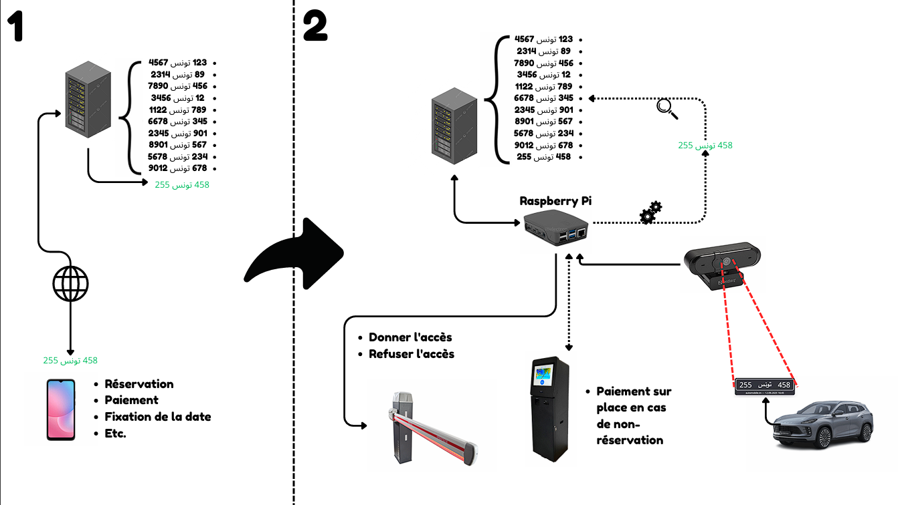
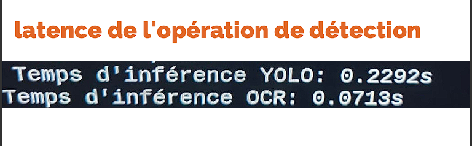
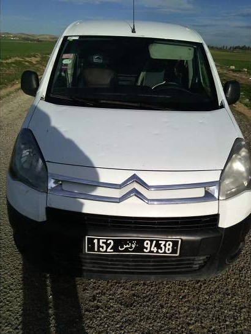
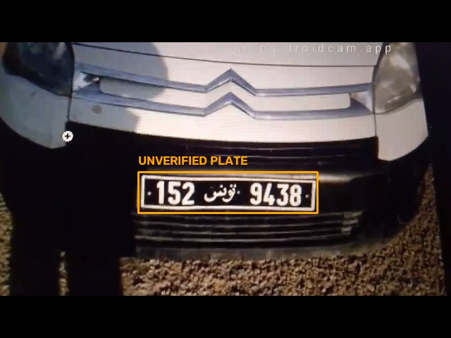
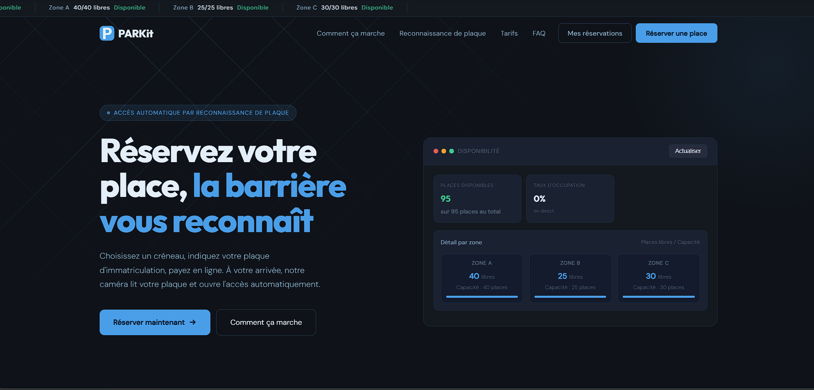
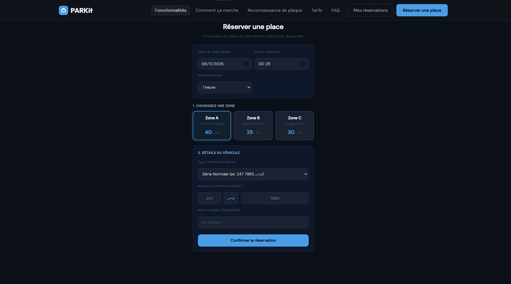
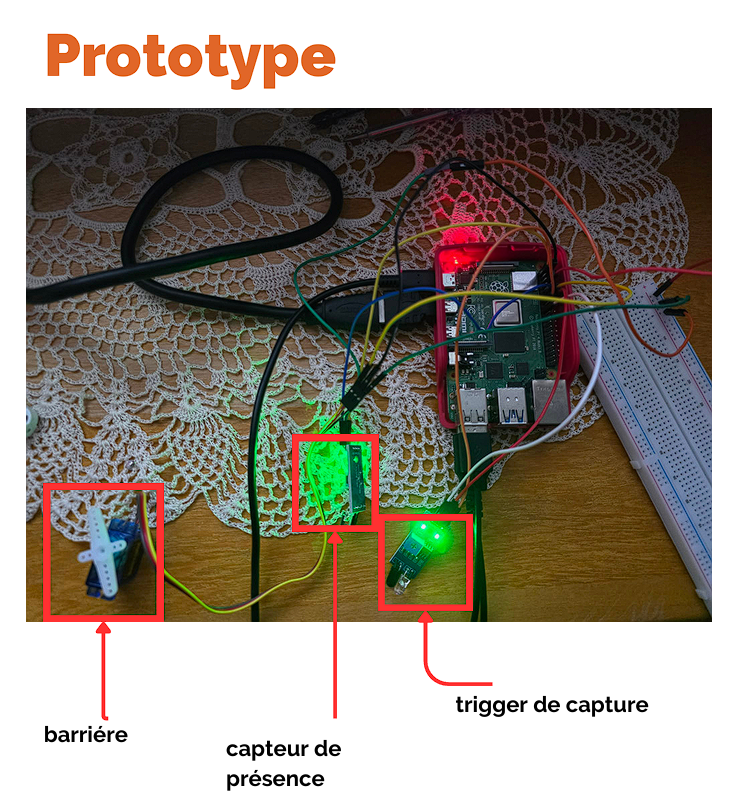

# PARKit : Parking automatisé par reconnaissance de plaque d'immatriculation


PARKit est un système d'accès pour parking basé sur la lecture des plaques d'immatriculation tunisiennes. Le conducteur **réserve et paie en ligne** ; à son arrivée, une caméra reliée à un **Raspberry Pi 4** lit la plaque, vérifie la réservation auprès du serveur et **ouvre automatiquement la barrière**.

> Projet réalisé lors de mon stage d'été de 2ème année chez **SKIDATA**, sous l'encadrement de **M. Ramzi Bouali**, avec l'appui de l'entreprise (encadrement et matériel).



## Fonctionnement

1. **Réservation :** sur le site PARKit, le conducteur choisit une zone et un créneau, saisit sa plaque et paie. La réservation est enregistrée dans MySQL.
2. **Déclenchement :** lorsqu'un véhicule atteint le premier capteur infrarouge (**IR1**), le Pi capture une image avec la caméra.
3. **Reconnaissance :** un modèle YOLO (NCNN) détecte la plaque, puis l'OCR FastPlate la lit. Le texte est normalisé selon les formats de plaques tunisiennes **STD** (`247 تونس 7965`), **RS** (`RS 123456`) et **GOV** (`12 - 3456`).
4. **Décision :** le Pi envoie la plaque à l'API du serveur. Celui-ci cherche une réservation couvrant l'heure actuelle, passe son statut à `checked_in` et renvoie **accès accordé ou refusé**.
5. **Ouverture :** si l'accès est accordé, la barrière (servomoteur) s'ouvre dès que le second capteur (**IR2**) confirme la présence du véhicule. Elle se referme quand IR2 est resté libre quelques secondes : elle ne se ferme jamais tant qu'un véhicule est devant.

Le Pi et le serveur sont sur le même réseau local. Le Pi n'accède jamais directement à la base de données : toutes les décisions passent par l'API du serveur.

### Modèle OCR

Le modèle OCR (FastPlate) a été **fine-tuné sur un jeu de données de plaques d'immatriculation tunisiennes**, afin de mieux gérer les plaques bilingues arabe/latin et le mot « تونس ».

## Résultats

Mesures sur un Raspberry Pi 4 (CPU uniquement, sans GPU) :

| Étape | Temps d'inférence |
|---|---|
| Détection de la plaque (YOLO, NCNN) | ~0,23 s |
| OCR (FastPlate) | ~0,07 s |



Le pipeline complet, de la détection à la décision, prend environ 0,3 s avant l'aller-retour réseau.

## Exemple de reconnaissance

<table>
  <tr>
    <td align="center"></td>
    <td align="center"></td>
    <td align="center"></td>
  </tr>
  <tr>
    <td align="center"><b>Photo d'entrée</b><br>Véhicule devant la caméra</td>
    <td align="center"><b>Plaque recadrée</b><br>Détectée par YOLO, transmise à l'OCR</td>
    <td align="center"><b>Résultat annoté</b><br>Enregistré dans <code>result.jpg</code></td>
  </tr>
</table>

L'image annotée suit un code couleur : **vert** = accès accordé, **rouge** = accès refusé, **orange** = plaque détectée mais format non reconnu (`UNVERIFIED PLATE`, comme sur cette capture).

## Site web

Le site de réservation est une application web (HTML, CSS, JavaScript, PHP) qui affiche la disponibilité en temps réel des trois zones du parking (95 places au total).





### Base de données

Le script SQL de la base `park_reservation_db` est fourni dans le dossier du site : [`parkit-website.server-side/park_reservation_db.sql`](parkit-website.server-side/park_reservation_db.sql).

## Prototype



| Composant | Rôle |
|---|---|
| Raspberry Pi 4 | Exécute la détection, l'OCR et le contrôle de la barrière |
| Webcam USB | Capture la plaque |
| Capteur IR 1 | Déclencheur de capture (véhicule en approche) |
| Capteur IR 2 | Capteur de présence (véhicule devant la barrière) |
| Servomoteur | Barrière |

### Brochage GPIO

Numérotation BCM, valeurs par défaut du code (modifiables dans le fichier `.env`, voir `.env.example`) :

| Élément | Variable | Broche par défaut |
|---|---|---|
| Capteur IR 1 (déclencheur) | `PARKIT_IR1_PIN` | GPIO 17 |
| Capteur IR 2 (présence) | `PARKIT_IR2_PIN` | GPIO 27 |
| Servomoteur (barrière) | `PARKIT_SERVO_PIN` | GPIO 18 |

Les modules IR « obstacle » passent généralement à `LOW` à la détection (`PARKIT_IR_ACTIVE_LOW=true`). Les angles du servomoteur (`PARKIT_SERVO_CLOSED_ANGLE`, `PARKIT_SERVO_OPEN_ANGLE`) et les temporisations de la barrière se règlent dans le même fichier.

### Séquence sur le Raspberry Pi

```
IR1 actif -> capture -> YOLO + OCR -> API serveur
          -> accès refusé : rien ne bouge
          -> accès accordé : attente IR2 (30 s max)
                IR2 actif -> ouverture du servo
                IR2 libre 2 s -> fermeture du servo
```

## API d'accès

`POST /api/access_checker.php`

En-têtes : `X-API-KEY: <clé>`, `Content-Type: application/json`

```json
{ "plate_left": "247", "plate_right": "7965", "plate_format": "STD" }
```

Réponse :

```json
{
  "access": true,
  "message": "ACCÈS ACCORDÉ | Code: PN-XXXXXX | Zone ID: 1 | Valide jusqu'à 18:30",
  "code": "PN-XXXXXX",
  "zone_id": 1,
  "valid_until": "18:30"
}
```

Le serveur gère plusieurs réservations le même jour ainsi que les réservations qui passent minuit. En cas de problème côté Pi (serveur injoignable, clé invalide, réponse illisible), le client **refuse l'accès** : la barrière ne s'ouvre jamais par défaut.

## Limites et pistes d'amélioration

- La précision de l'OCR dépend de l'éclairage et de l'état de la plaque ; les plaques bilingues arabe/latin restent le cas le plus difficile.
- L'inférence se fait uniquement sur CPU ; un accélérateur (Coral TPU) ou un modèle plus léger pourrait réduire la latence.
- Les échanges entre le Pi et le serveur se font en HTTP, acceptable sur un réseau local isolé ; utiliser HTTPS dans les autres cas.
- Borne de paiement sur place pour les conducteurs sans réservation (présente dans le schéma d'architecture).
- Tableau de bord de supervision et tests automatisés pour l'extraction des plaques.

## Remerciements

Merci à **SKIDATA** et à **M. Ramzi Bouali** pour l'encadrement et le matériel qui ont rendu ce prototype possible.


